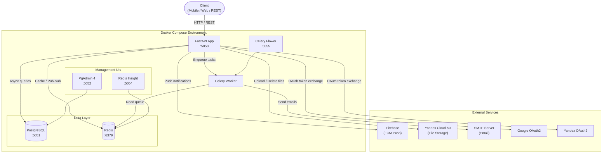
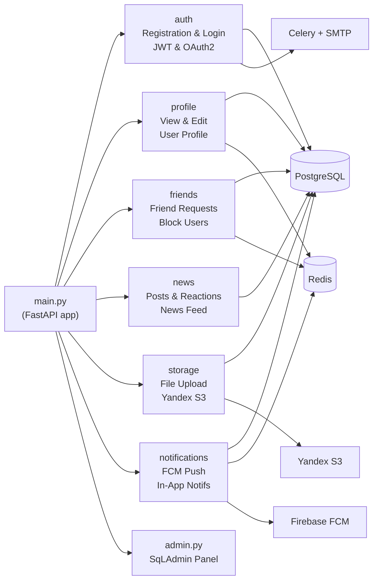
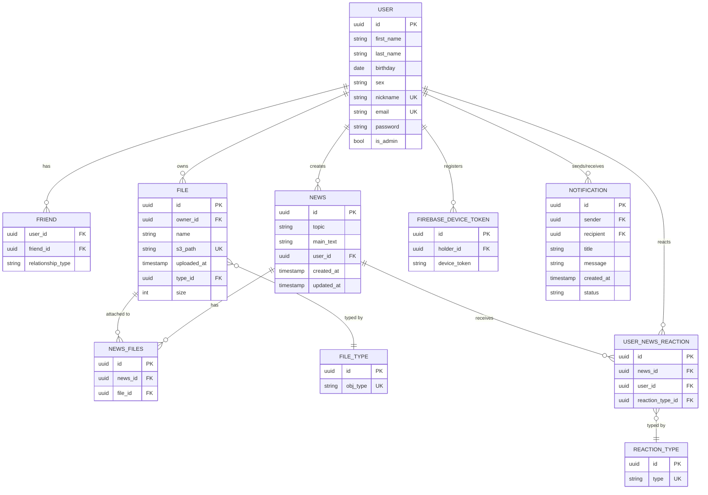
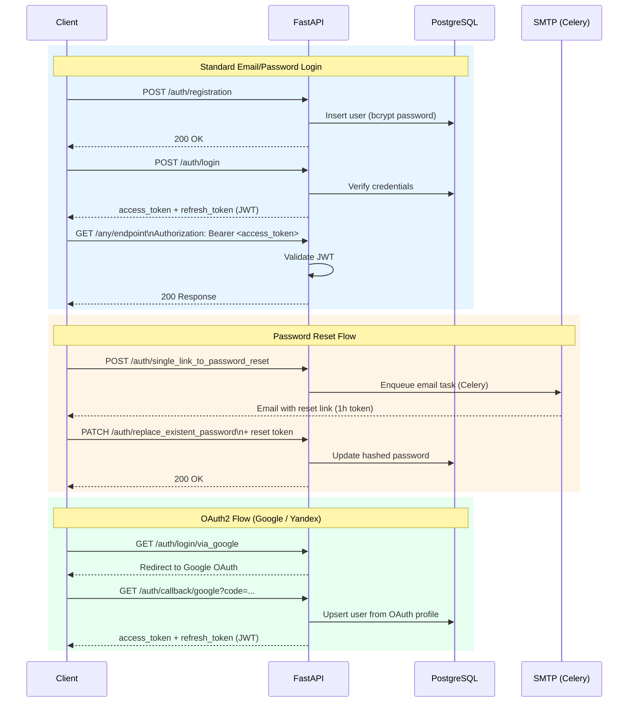
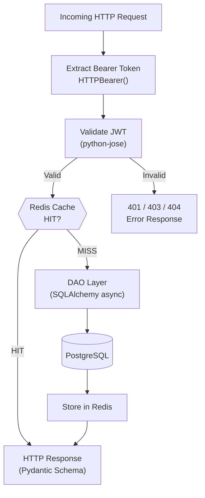

# 🌐 Friendly — Social Network API

> A production-ready social network backend built with **FastAPI**, featuring user authentication, friend management, a news feed with reactions, push notifications, and cloud file storage.

---

## Table of Contents

- [Overview](#overview)
- [Tech Stack](#tech-stack)
- [Architecture](#architecture)
  - [High-Level Architecture](#high-level-architecture)
  - [Module Structure](#module-structure)
  - [Database Schema](#database-schema)
  - [Authentication Flow](#authentication-flow)
  - [Request Lifecycle](#request-lifecycle)
- [Project Structure](#project-structure)
- [Getting Started](#getting-started)
  - [Prerequisites](#prerequisites)
  - [Environment Variables](#environment-variables)
  - [Running with Docker (Recommended)](#running-with-docker-recommended)
  - [Running Locally](#running-locally)
- [API Reference](#api-reference)
- [Testing](#testing)
- [Code Quality](#code-quality)

---

## Overview

**Friendly** is a feature-complete social network REST API that provides:

- **Authentication** — JWT-based auth with OAuth2 support (Google & Yandex), password reset via email
- **Profile Management** — View and edit user profiles, delete accounts
- **Friend System** — Send/accept friend requests, block users, browse the user feed
- **News Feed** — Create posts with file attachments, react with emoji (Like, Love, Fire, Sad)
- **Push Notifications** — Firebase Cloud Messaging (FCM) integration for real-time mobile notifications
- **File Storage** — Upload images, videos, and audio files to Yandex Cloud S3 (S3-compatible)
- **Admin Panel** — SqLAdmin-powered management interface for all entities
- **Async Task Queue** — Celery + Redis for background jobs (email delivery, etc.)
- **Caching** — Redis caching layer on hot endpoints

---

## Tech Stack

| Category | Technology |
|---|---|
| **Framework** | FastAPI 0.111 |
| **Language** | Python 3.12 |
| **Database** | PostgreSQL 17 |
| **ORM** | SQLAlchemy 2.0 (async) |
| **Migrations** | Alembic |
| **Caching** | Redis 7 |
| **Task Queue** | Celery 5 + Redis broker |
| **Auth** | JWT (python-jose), bcrypt (passlib), OAuth2 (Authlib) |
| **Email** | FastAPI-Mail (SMTP) |
| **Push Notifications** | Firebase Admin SDK (FCM) |
| **File Storage** | Yandex Cloud S3 (aiobotocore) |
| **Admin Panel** | SqLAdmin |
| **Testing** | pytest, pytest-asyncio, fakeredis |
| **Containerization** | Docker + Docker Compose |
| **Code Quality** | black, isort, flake8, pre-commit |
| **Logging** | Loguru |
| **Monitoring** | Celery Flower |

---

## Architecture

### High-Level Architecture



---

### Module Structure

Each business domain is a self-contained module under `friendly/application/` with its own router, models, schemas, DAO, and exceptions.



---

### Database Schema



---

### Authentication Flow



---

### Request Lifecycle



---

## Project Structure

```
Social-Network-FastAPI/
├── friendly/                          # Application root
│   ├── application/                   # Business domain modules
│   │   ├── auth/                      # Registration, login, OAuth2, JWT
│   │   │   ├── constants.py
│   │   │   ├── dao.py
│   │   │   ├── dependensies.py        # FastAPI dependency injectors
│   │   │   ├── models.py              # User SQLAlchemy model
│   │   │   ├── request_body.py        # Pydantic request schemas
│   │   │   ├── router.py              # Auth endpoints
│   │   │   ├── schemas.py             # Pydantic response schemas
│   │   │   └── utils.py
│   │   ├── core/                      # Shared utilities
│   │   │   ├── exceptions.py
│   │   │   ├── model_types.py
│   │   │   └── responses.py
│   │   ├── friends/                   # Friend requests & blocking
│   │   │   ├── dao.py
│   │   │   ├── exceptions.py
│   │   │   ├── models.py
│   │   │   ├── router.py
│   │   │   └── schemas.py
│   │   ├── news/                      # Posts, feed, reactions
│   │   │   ├── constants.py
│   │   │   ├── dao.py
│   │   │   ├── models.py
│   │   │   ├── request_body.py
│   │   │   ├── router.py
│   │   │   └── schemas.py
│   │   ├── notifications/             # FCM push & in-app notifications
│   │   │   ├── dao.py
│   │   │   ├── exceptions.py
│   │   │   ├── models.py
│   │   │   ├── request_body.py
│   │   │   ├── router.py
│   │   │   └── schemas.py
│   │   ├── profile/                   # Profile view & edit
│   │   │   ├── dao.py
│   │   │   ├── request_body.py
│   │   │   ├── router.py
│   │   │   ├── schemas.py
│   │   │   └── utils.py
│   │   └── storage/                   # File upload & delete
│   │       ├── dao.py
│   │       ├── models.py
│   │       ├── router.py
│   │       └── schemas.py
│   ├── auth/                          # Auth utilities
│   │   ├── auth.py                    # JWT creation & decoding
│   │   ├── google_oauth.py            # Google OAuth2 client
│   │   ├── hashing_password.py        # bcrypt helpers
│   │   └── yandex_oauth.py            # Yandex OAuth2 client
│   ├── data_access_object/
│   │   └── base.py                    # Base DAO with generic CRUD
│   ├── firebase/
│   │   ├── __init__.py
│   │   └── notification.py            # FCM push sender
│   ├── mail/
│   │   ├── __init__.py
│   │   ├── mail_sender.py             # Celery email task
│   │   └── templates/                 # HTML email templates
│   ├── object_storage_service/
│   │   └── s3.py                      # Yandex S3 async client
│   ├── redis_service/
│   │   └── __init__.py                # Redis cache helpers
│   ├── task_queue/
│   │   ├── __init__.py
│   │   └── celery_settings.py         # Celery app configuration
│   ├── static/
│   │   └── images/
│   ├── admin.py                       # SqLAdmin panel setup
│   ├── config.py                      # Pydantic settings (reads .env)
│   ├── database.py                    # SQLAlchemy async engine & session
│   ├── logger_config.py               # Loguru configuration
│   └── main.py                        # FastAPI app & router registration
│
├── tests/
│   ├── conftest.py                    # Fixtures (async DB, fake Redis, etc.)
│   ├── unit/                          # Unit tests (no DB)
│   │   ├── auth/
│   │   ├── profile/
│   │   └── friends/
│   └── integration/                   # Integration tests (real test DB)
│       ├── auth/
│       ├── profile/
│       ├── friends/
│       └── data_access_object/
│
├── migrations/                        # Alembic migration scripts
│   ├── env.py
│   ├── script.py.mako
│   └── versions/
│
├── scripts/
│   └── load_values_db.py              # DB seed script (reaction types, file types)
├── seed_data/                         # JSON seed data files
├── Dockerfile
├── docker-compose.yaml
├── pyproject.toml                     # Poetry dependencies
├── alembic.ini
├── prestart.sh                        # Runs migrations before app starts
├── .env.example                       # Environment variable template
├── .pre-commit-config.yaml
├── .flake8
└── .coveragerc
```

---

## Getting Started

### Prerequisites

| Tool | Version |
|---|---|
| Python | 3.12+ |
| Docker | 24+ |
| Docker Compose | 2.x |
| Poetry | 1.8+ *(local dev only)* |

---

### Environment Variables

Copy the example file and fill in your values:

```bash
cp .env.example .env
```

| Variable | Description | Example |
|---|---|---|
| `DB_HOST` | PostgreSQL host | `localhost` |
| `DB_PORT` | PostgreSQL port | `5432` |
| `DB_USER` | PostgreSQL username | `postgres` |
| `DB_PASS` | PostgreSQL password | `secret` |
| `DB_NAME` | Database name | `friendly_db` |
| `TEST_DB_NAME` | Test database name | `friendly_test_db` |
| `SECRET_KEY` | JWT signing secret | *(random 64-char string)* |
| `ALGORITHM` | JWT algorithm | `HS256` |
| `FRONTEND_URL` | Used in reset-password emails | `http://localhost:3000/` |
| `MAIL_USERNAME` | SMTP login / PgAdmin email | `you@example.com` |
| `MAIL_PASSWORD` | SMTP password | |
| `MAIL_PORT` | SMTP port | `465` |
| `MAIL_SERVER` | SMTP server host | `smtp.gmail.com` |
| `ADMIN_PASSWORD` | PgAdmin default password | |
| `GOOGLE_CLIENT_ID` | Google OAuth2 client ID | |
| `GOOGLE_CLIENT_SECRET` | Google OAuth2 client secret | |
| `YDEX_CLIENT_ID` | Yandex OAuth2 client ID | |
| `YDEX_CLIENT_SECRET` | Yandex OAuth2 client secret | |
| `AWS_ACCESS_KEY_ID` | Yandex S3 static key ID | |
| `AWS_SECRET_ACCESS_KEY` | Yandex S3 secret key | |
| `AWS_REGION_NAME` | S3 region | `ru-central1` |
| `AWS_ENDPOINT_URL` | S3 endpoint | `https://storage.yandexcloud.net` |
| `AWS_BUCKET_NAME` | S3 bucket name | |
| `REDIS_URL` | Redis connection URL | `redis://localhost:6379` |

---

### Running with Docker (Recommended)

This brings up the full stack: FastAPI, PostgreSQL, Redis, Celery worker, Celery Flower, PgAdmin4, and Redis Insight.

```bash
# 1. Configure environment
cp .env.example .env
# Edit .env with your values

# 2. Build and start all services
docker compose up -d

# 3. Apply database migrations (first run only)
docker compose exec app alembic upgrade head

# 4. Seed lookup data (reaction types, file types)
docker compose exec app python ../scripts/load_values_db.py
```

**Service URLs after startup:**

| Service | URL |
|---|---|
| FastAPI (Swagger UI) | http://localhost:5050/docs |
| FastAPI (ReDoc) | http://localhost:5050/redoc |
| Admin Panel | http://localhost:5050/admin |
| PgAdmin 4 | http://localhost:5052 |
| Redis Insight | http://localhost:5054 |
| Celery Flower | http://localhost:5555 |

```bash
# View application logs
docker compose logs app -f

# Stop all services
docker compose down

# Stop and remove volumes (wipes database)
docker compose down -v
```

---

### Running Locally

```bash
# 1. Install dependencies
poetry install

# 2. Configure environment
cp .env.example .env
# Edit .env — set DB_HOST=localhost, REDIS_URL=redis://localhost:6379

# 3. Start PostgreSQL (macOS with Homebrew)
brew services start postgresql@17

# 4. Apply migrations
alembic upgrade head

# 5. Seed lookup data
python ./scripts/load_values_db.py

# 6. Start the FastAPI server
cd friendly
poetry run python main.py
# Swagger UI available at http://localhost:8000/docs

# 7. Start the Celery worker (separate terminal)
cd friendly
poetry run celery -A task_queue.__init__:celery worker --loglevel=INFO --pool=solo

# 8. Start Celery Flower monitoring (optional, separate terminal)
cd friendly
poetry run celery -A task_queue.__init__:celery flower --address=127.0.0.1 --port=5555
```

---

## API Reference

The full interactive API documentation is auto-generated by FastAPI:

- **Swagger UI** — http://localhost:5050/docs
- **ReDoc** — http://localhost:5050/redoc

### Endpoint Summary

| Module | Method | Path | Description |
|---|---|---|---|
| **Auth** | POST | `/auth/registration` | Register a new user |
| | POST | `/auth/login` | Login, receive JWT tokens |
| | POST | `/auth/refresh_access_token` | Refresh access token |
| | POST | `/auth/change_password` | Change password (authenticated) |
| | POST | `/auth/single_link_to_password_reset` | Send password reset email |
| | PATCH | `/auth/replace_existent_password` | Set new password via reset token |
| | GET | `/auth/login/via_google` | Initiate Google OAuth2 login |
| | GET | `/auth/callback/google` | Google OAuth2 callback |
| | GET | `/auth/login/via_yandex` | Initiate Yandex OAuth2 login |
| | GET | `/auth/callback/yandex` | Yandex OAuth2 callback |
| **Profile** | GET | `/profile/get_information` | Get profile info (own or other user) |
| | PATCH | `/profile/update_information` | Update profile fields |
| | DELETE | `/profile/delete_account` | Delete own account |
| **Friends** | GET | `/users/feed/list` | Browse all users |
| | POST | `/users/friend/add/{friend_id}` | Send a friend request |
| | GET | `/users/friends` | List your friends |
| | GET | `/users/friend/incoming_friend_requests` | Pending incoming requests |
| | PATCH | `/users/friend/accept/{friend_id}` | Accept a friend request |
| | PUT | `/users/ban_user/{ban_user_id}` | Block / unblock a user |
| | DELETE | `/users/friend/remove/{friend_id}` | Remove a friend |
| **News** | POST | `/news/produce_content` | Create a post (with attachments) |
| | GET | `/news/feed/list` | Get news feed |
| | GET | `/news/feed/{news_id}` | Get a specific post with reactions |
| | POST | `/news/add_reaction/{news_id}` | React to a post (Like/Love/Fire/Sad) |
| | DELETE | `/news/erase_post/{post_id}` | Delete your post |
| **Storage** | POST | `/storage/upload-file/` | Upload a file (max 20 MB) |
| | DELETE | `/storage/destroy-file/{file_name}` | Delete a file |
| **Notifications** | POST | `/notify/connect-to-firebase` | Register device for push notifications |
| | GET | `/notify/notifications` | List your notifications |
| | PATCH | `/notify/mark-notify-read/{n_id}` | Mark a notification as read |
| | DELETE | `/notify/clear-notifications` | Clear all notifications |

---

## Testing

Tests are split into **unit** (no database) and **integration** (runs against a real test database).

```bash
# Run the full test suite
cd friendly
poetry run pytest ../tests/

# Run with coverage report (terminal)
poetry run pytest --cov .

# Generate HTML coverage report
coverage html
# Open htmlcov/index.html in your browser

# Run a specific test file
poetry run pytest ../tests/integration/auth/login_test.py -v

# Run only unit tests
poetry run pytest ../tests/unit/ -v

# Run only integration tests
poetry run pytest ../tests/integration/ -v
```

> **Note:** Integration tests require a running PostgreSQL instance. Set `TEST_DB_NAME` in your `.env` to use a separate test database. Redis is mocked with `fakeredis` so no Redis instance is needed for tests.

---

## Code Quality

The project uses **pre-commit hooks** to enforce code style on every commit.

```bash
# Install hooks (one-time setup)
pre-commit install

# Run all checks manually
pre-commit run --all-files

# Format code with Black
poetry run black .

# Sort imports with isort
poetry run isort .

# Lint with Flake8
poetry run flake8 .
```

Configuration files:
- `.flake8` — Flake8 rules (max line length, ignored codes, etc.)
- `pyproject.toml` — Black & isort configuration
- `.pre-commit-config.yaml` — Hook definitions
- `.coveragerc` — Coverage reporting configuration

---

*Author: [@Raisin228](https://github.com/Raisin228)*